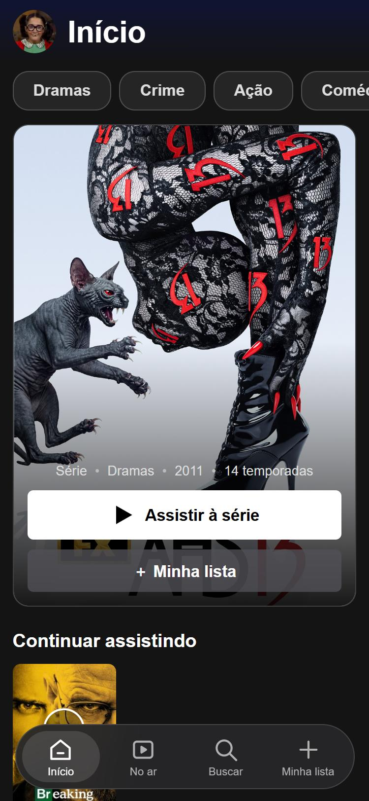
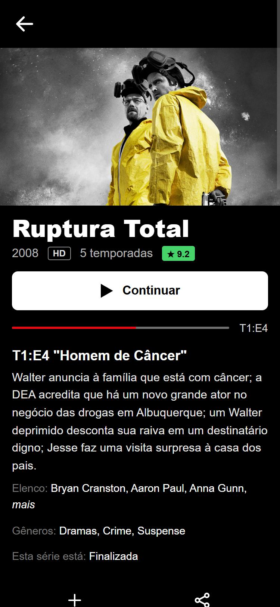
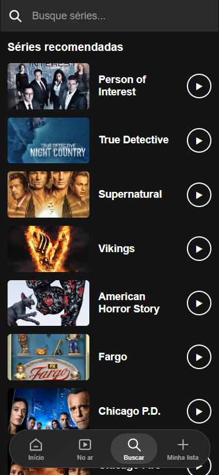
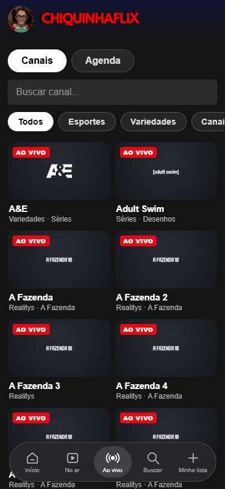
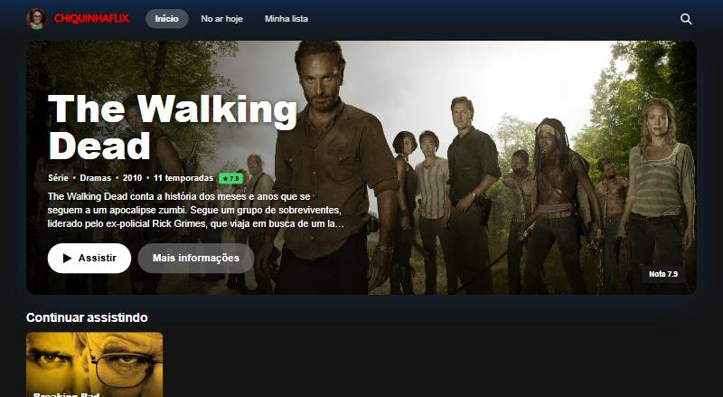
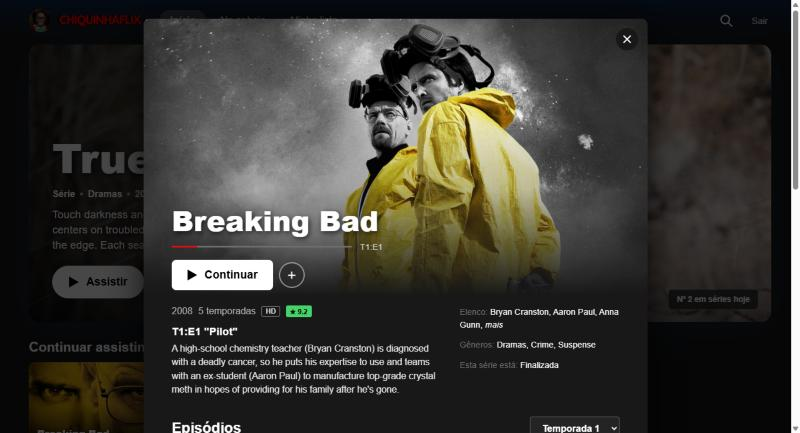
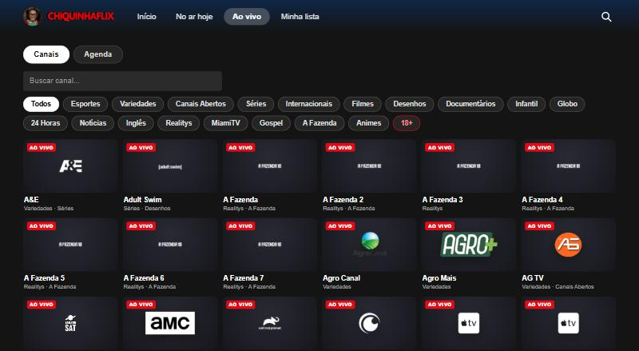

# 📺 ChiquinhaFlix

> Um visualizador de séries pessoal, feito por diversão. Evolução de um projetinho do ensino médio.

**🔗 Online:** https://carlosmirandd.github.io/chiquinhaflix/

### No celular

| Início | Detalhes | Episódios | Busca | Ao vivo |
|---|---|---|---|---|
|  |  |  |  |  |

### No computador

| Início | Detalhes | Ao vivo |
|---|---|---|
|  |  |  |

## O contexto

O **ChiquinhaFlix** nasceu em **março de 2023**, num trabalho em grupo da disciplina de *Apps II* (6º período do ensino médio): um app em React Native, rodando no Expo Snack, com tela de login, um filme de exemplo e uma estrelinha de favorito. Era a época em que ainda programávamos sem IA, e o resultado era charmoso do jeito que só projeto de escola consegue ser.

Esta versão pega a ideia original e a transforma num **site de verdade**: HTML, CSS e JavaScript puros, sem build, sem dependências e sem servidor. Mantive o clima da versão original:

- a **logo** (a Chiquinha e o nome);
- a **estrela de favoritos**, agora "Minha lista";
- o visual segue o estilo dos grandes serviços de streaming (banner em destaque, fileiras, Top 10, modal de detalhes), mas com marca própria e sem usar nome nem logo de nenhum deles.

A tela de login da versão original saiu: como tudo fica no seu navegador, não faz sentido ter conta.

## O que ele faz

- **Layout de app no celular**: barra inferior flutuante, banner vertical, categorias em botões, detalhes em tela cheia e busca em tela própria. No computador, vira um layout de TV/desktop com modal de detalhes.
- Banner em destaque, fileiras por gênero, **Top 10**, **Continuar assistindo** (com barra de progresso) e **No ar hoje**.
- **Busca** por nome e navegação por **gênero**.
- **Detalhes** com elenco, gêneros, status, "Continuar" e lista de episódios por temporada. Os já vistos ganham a barra vermelha.
- Player com seletor de **temporada** e **episódio**, anterior/próximo (passam sozinhos para a temporada seguinte).
- **Minha lista** e **histórico**, guardados no `localStorage`. Nada sai da sua máquina.
- **Miniplayer**: ao sair da tela de um canal, evento ou episódio, o vídeo continua num player flutuante (sem recarregar), com um botão para voltar à tela do player e outro para fechar. Na tela do player há também "Parar e sair".
- **Ao vivo**: lista de **canais** (com busca e categorias) e **agenda esportiva** (eventos ao vivo, em breve e finalizados, com troca de canal), tudo aberto pelo embed do SuperFlix. Os canais de conteúdo adulto ficam escondidos atrás do chip **18+**, que pede confirmação (veja abaixo).
- **Textos em português** (veja abaixo).
- **Modo TV**: navegação pelas setas do controle remoto (Android TV/box, Tizen, webOS), com foco bem visível, letras maiores, OK para abrir e Voltar para sair. Liga sozinho em TVs conhecidas; nas demais use `?tv=1` no endereço (ou o link "Modo TV" no rodapé). Na tela do player, o botão **Controlar vídeo** passa o teclado para o player do SuperFlix.
- **PWA**: dá para instalar como app (Android/Chrome: menu → *Instalar app*; iPhone/Safari: Compartilhar → *Adicionar à Tela de Início*). Abre em tela cheia, com ícone próprio, e o "esqueleto" do site abre mesmo sem internet (os dados e vídeos continuam precisando de rede).

## Como funciona

| Parte | Origem |
|---|---|
| Catálogo, capas, imagens de fundo, temporadas, episódios, elenco, títulos e sinopses em português | [TMDB API](https://www.themoviedb.org/documentation/api), consultada pelo **Worker da Cloudflare**, que guarda a chave |
| Sinopses que faltam em português | Tradução automática, só nesses casos (veja abaixo) |
| Vídeo das séries | `iframe` (embed) de um serviço de terceiros, o [SuperFlixAPI](https://superflixapi.fun/doc), aberto pelo ID da TMDB da série |
| Canais ao vivo | Lista própria em `canais.json` (um retrato da página de canais do SuperFlix) e player `https://superflixapi.fun/canal/{canal}` |
| Agenda esportiva | Lista de eventos do SuperFlix lida por um **Worker da Cloudflare** seu (`cloudflare/worker.js`); plano B: `agenda.json`. Cada evento abre pelo embed `https://superflixapi.fun/eventos/{evento}` |

A chave da TMDB **não está no código nem no repositório**: ela fica como segredo do Worker (`TMDB_KEY`) e o site só fala com o Worker, que aceita apenas consultas de uma lista fixa (`/tmdb/...`) e só responde ao endereço do site. Quem clonar o projeto precisa de uma chave própria (gratuita) e do próprio Worker: `python cloudflare/publicar.py --tmdb SUA_CHAVE`.

### Sobre os canais e a agenda

- O SuperFlix não libera a leitura da lista por outros sites (CORS), então a lista de canais é um **retrato** salvo em `canais.json`, com nome, endereço do canal e categorias. Canais novos ou removidos só aparecem quando esse arquivo for atualizado. Os logos vêm direto do SuperFlix.
- A **agenda** é montada pelo próprio app. A API de eventos do SuperFlix **não manda o cabeçalho CORS** (`access-control-allow-origin`), então o navegador não consegue lê-la direto. Por isso existe um **Worker da Cloudflare** (`cloudflare/worker.js`) que faz a chamada pelo servidor, guarda a resposta em cache por 5 minutos e devolve só o necessário, com o CORS liberado apenas para o site. Para publicá-lo, rode uma vez `python cloudflare/publicar.py` (passo a passo em [`cloudflare/LEIAME.md`](cloudflare/LEIAME.md)); o endereço dele fica em `config.js`.
- No app, a agenda aparece **na hora** (a última salva no navegador ou o `agenda.json` do site) e é atualizada pelo Worker em segundo plano, com cache de 5 minutos e um botão **Atualizar** (só vale a cada 10 segundos). Se o Worker falhar, o app lembra a falha por 5 minutos. A tela diz de onde vieram os dados e há quanto tempo.
- **Privacidade:** o Worker enxerga as chamadas do seu site (o IP de quem abre a agenda) e não guarda nada.
- O `agenda.json` é o plano B (também usado enquanto o Worker não estiver publicado). Para gerá-lo e publicá-lo, no PC: `python tools/atualizar_agenda.py --publicar` (gera o arquivo e faz `add`, `commit` e `push` só dele). O script faz **uma** chamada, espera uma vez se levar "429" e, se falhar de novo, mantém o arquivo antigo. Não rode em laço. `python servidor.py` abre o app local e mantém o arquivo atualizado (no máximo a cada 5 minutos). Não há automação (GitHub Actions) de propósito.
- Se os dados estiverem velhos, a tela avisa e ajusta o status pelo horário do jogo (por exemplo, um jogo que começou há mais de 3 horas passa a "Finalizado").
- Os canais da categoria **Adulto** (11 canais, a maioria de conteúdo explícito) ficam fora de "Todos" e das outras categorias. Eles só aparecem no chip **18+**, depois de uma confirmação de idade guardada no seu navegador (`localStorage`). O Adult Swim, por exemplo, é um canal de séries e desenhos e aparece normalmente.

### Sobre o português e a tradução

A TMDB já entrega títulos, sinopses e episódios em português do Brasil (o Worker pede `pt-BR`). Quando uma sinopse não existe em português (comum em episódios), o app pega a versão em inglês e a **traduz automaticamente** pelo próprio navegador, chamando o endpoint público do Google Tradutor e, se ele falhar, o [MyMemory](https://mymemory.translated.net/). As traduções ficam em cache no `localStorage`.

Nesse caso **o texto da sinopse (dado público de série) é enviado a esses serviços de tradução**. Nenhum dado pessoal vai junto. O endpoint do Google usado é o não oficial (`translate.googleapis.com`), então pode mudar ou deixar de funcionar sem aviso, e a qualidade é a de uma tradução automática.

Quem já usava o app antes da TMDB não perde nada: na primeira abertura, **Minha lista**, **Continuar assistindo** e os episódios vistos são convertidos para o novo catálogo (as séries são achadas de novo pelo ID do IMDb).

## Como rodar

É um site estático. Sirva a pasta com o Python 3:

```bash
python -m http.server 8000
```

Depois acesse `http://localhost:8000`.

Opcional: `python servidor.py` faz a mesma coisa e ainda mantém o `agenda.json` atualizado. Com `python servidor.py --lan`, o celular na mesma rede Wi-Fi também consegue abrir o app pelo IP do computador.

## Aviso importante

Este é um **projeto pessoal, educacional e sem fins lucrativos**.

- Este repositório **não hospeda, não armazena e não distribui nenhum vídeo**. Ele só exibe um `iframe` apontando para um serviço de terceiros.
- Não tenho controle sobre o conteúdo desse serviço, nem garantias sobre a licença dos vídeos que ele serve. **Cada pessoa é responsável pelo que acessa** e deve respeitar a legislação de direitos autorais do seu país.
- O serviço de terceiros **libera o embed só para domínios autorizados**. Em domínios não autorizados (incluindo `localhost`), o player mostra "Embed não disponível aqui" em vez do vídeo. Ele também pode exibir uma verificação da Cloudflare (anti-bot) ou ficar indisponível a qualquer momento. Nada disso depende deste código: o catálogo, a busca, a minha lista e o histórico funcionam normalmente mesmo sem o vídeo.
- O projeto cobre **séries sob demanda, canais ao vivo e a agenda esportiva**. Não há filmes.
- Canais de TV e eventos esportivos ao vivo, como as séries, são servidos por um terceiro sem relação com este código. Nada disso é licenciado por este projeto, e ele existe só como uso pessoal.
- Se o repositório for tornado **privado**, o site do GitHub Pages sai do ar no plano gratuito (Pages para repositório privado exige plano pago). Nesse caso, rode localmente com `python servidor.py`.

## Créditos

- Este produto usa a API da [TMDB](https://www.themoviedb.org), mas não é endossado nem certificado pela TMDB. Dados de séries e imagens: TMDB (uso pessoal e sem fins lucrativos).
- Projeto original (2023): ChiquinhaFlix, feito em grupo para a disciplina de Apps II.
- A imagem da logo vem do projeto original e é uma homenagem pessoal a ele, sem fins comerciais.

## Estrutura

```
index.html   → telas (início, lista, ao vivo, player, detalhes, barra inferior)
style.css    → visual (desktop e celular)
tv.js        → modo TV (setas do controle remoto)
manifest.webmanifest, sw.js → PWA (instalação e abertura offline)
app.js       → lógica (TMDB, tradução, canais, player, minha lista, histórico)
canais.json  → lista de canais ao vivo (retrato do SuperFlix)
agenda.json  → plano B da agenda esportiva (gerado pelo script)
config.js    → endereço do Worker da agenda (preenchido por cloudflare/publicar.py)
cloudflare/  → Worker da agenda, script de publicação e passo a passo
servidor.py  → servidor local opcional que mantém o agenda.json atualizado
tools/       → atualizar_agenda.py
assets/      → logo (rosto e nome recortados do original)
docs/        → prints usados neste README
```

## Licença

O código é distribuído sob a licença [MIT](LICENSE). A licença **não** cobre a logo nem os dados e imagens da TMDB, que seguem seus próprios termos.
